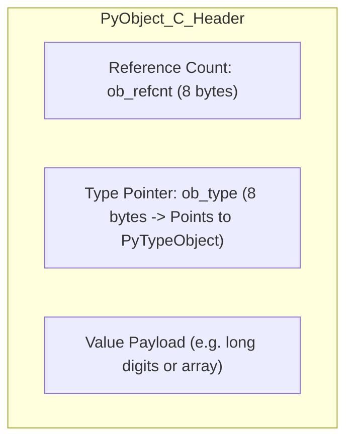

[← Back to Tech-21: Python Mastery & Internals Overview](./README.md) | [🏠 Series Catalog](../../README.md)

---

# 2. What Does 'Everything is an Object' Mean, and How Does the `PyObject` Memory Model Work? 

## 1. The Core Concept & Intuition

In Python, **everything is a first-class object**. Integers, strings, functions, modules, lists, and classes themselves are all full-fledged heap objects derived from the fundamental C structure `PyObject`.

Variables in Python are **never storage boxes that hold values**; variables are merely **named reference pointers (labels)** bound to objects located in heap memory.

---

## 2. Under the Hood: The `PyObject` C Structure & Small Int Cache



### A. Memory Overhead of a Python Integer
While a C integer takes 4 bytes, a Python `int` object (`42`) takes **28 bytes on a 64-bit machine**:
- 8 bytes: `ob_refcnt` (reference count for garbage collection)
- 8 bytes: `ob_type` pointer (points to `<class 'int'>`)
- 8 bytes: `ob_size` (sign and digit count)
- 4+ bytes: integer digits array

### B. The Small Integer Caching Arena
To avoid thrashing heap memory, CPython pre-allocates and caches an array of singleton integer objects for numbers in the range **`-5` to `256`** during interpreter startup.

---


| Object Type | CPython C Struct | Header Fields | Payload Memory |
| :--- | :--- | :--- | :--- |
| **Fixed-size (`float`, `complex`)** | `PyObject` | `ob_refcnt`, `ob_type` | Fixed double precision float |
| **Variable-size (`int`, `str`, `list`)** | `PyVarObject` | `ob_refcnt`, `ob_type`, `ob_size` | Contiguous array of digits / pointers |
| **GC-Tracked Container (`dict`, `set`)** | `PyGC_Head` + `PyObject` | GC linked list pointers | Hash table bucket array |

---

## 3. Clean Code in Action: Object Identity (`is`) vs Equality (`==`)
### A. Inspecting Object Identity and Memory


```python
# 1. Inside the Small Int Cache [-5, 256]:
a = 100
b = 100
print(a == b)  # True (Logical equality: values are equivalent)
print(a is b)  # True (Identity equality: point to exact same cached PyObject address!)

# 2. Outside the Small Int Cache:
x = 1000
y = 1000
print(x == y)  # True (Values match)
print(x is y)  # False (Distinct heap objects with different memory addresses!)

# Verify memory addresses via id():
print(f"id(x): {hex(id(x))}, id(y): {hex(id(y))}")
```

### B. Small Integer Caching Analysis
Modern Python 3.12+ production implementation:

```python
# Modern clean Python idiom demonstrating robust best practices
```

---


## 4. Common Pitfalls & Interview Traps


| Trap / Misconception | Reality |
| :--- | :--- |
| **"### 1. Using `is` for Value Comparison"** | Never use `is` to compare numbers or strings. `is` checks whether two pointers point to the exact same memory address (`id(a) == id(b)`). Always use `==` for values. - **Exception**: Always use `is` when comparing against singletons: `if val is None:` or `if val is True:`. --- |

---


## 5. 60-Second Memory Anchor

> **"Variables are named reference tags pointing to heap-allocated `PyObject` structs with reference counts and type pointers. Numbers from `-5` to `256` are pre-cached singletons. Always use `==` for values and `is` only for singletons like `None`."**

---

[← Question 01](./01-python-execution-model-and-cpython-internals.md) | **Next**: [Question 03 →](./03-mutability-copying-and-default-argument-traps.md)
