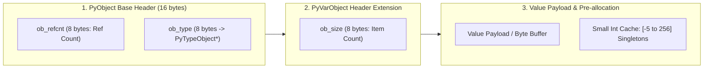

[← Back to Tech-21: Python Mastery & Internals Overview](./README.md) | [🏠 Series Catalog](../../README.md)

---

# 2. What Does 'Everything is an Object' Mean, and How Does the `PyObject` Memory Model Work? 

## 1. The Core Concept & Intuition

In Python, **everything is a first-class object**. Integers, strings, functions, modules, lists, and classes themselves are all full-fledged heap objects derived from the fundamental C structure `PyObject`.

Variables in Python are **never storage boxes that hold values**; variables are merely **named reference pointers (labels)** bound to objects located in heap memory.

---

## 2. Under the Hood: The `PyObject` C Structure & Small Int Cache



- **Memory Overhead of a Python Integer**: While a C integer takes 4 bytes, a Python `int` object (`42`) takes **28 bytes on a 64-bit machine**:
  - 8 bytes: `ob_refcnt` (reference count for garbage collection)
  - 8 bytes: `ob_type` pointer (points to `<class 'int'>`)
  - 8 bytes: `ob_size` (sign and digit count)
  - 4+ bytes: integer digits array
- **The Small Integer Caching Arena**: To avoid thrashing heap memory, CPython pre-allocates and caches an array of singleton integer objects for numbers in the range **`-5` to `256`** during interpreter startup.

| Object Category | CPython C Struct | Header Fields | Payload Memory & Allocator |
| :--- | :--- | :--- | :--- |
| **Fixed-size (`float`, `complex`)** | `PyObject` | `ob_refcnt`, `ob_type` | 8-byte C `double` scalar |
| **Variable-size (`int`, `str`, `list`)** | `PyVarObject` | `ob_refcnt`, `ob_type`, `ob_size` | Contiguous array of digits / pointer references |
| **GC Container (`dict`, `set`, `custom`)** | `PyGC_Head` + `PyObject` | GC linked list pointers + base header | Dynamic hash table buckets / instance `__dict__` |

---

## 3. Clean Code in Action

### A. Inspecting Object Identity and Memory
```python
import sys

# 1. Inside the Small Int Cache [-5, 256]:
a: int = 100
b: int = 100
print(a == b)  # True (Logical equality: values are equivalent)
# True (Identity equality: same pre-allocated singleton address!)
print(a is b)

# 2. Outside the Small Int Cache:
x: int = 1000
y: int = 1000
print(x == y)  # True (Values match)
# False (Distinct heap allocations with distinct memory addresses)
print(x is y)

print(f"Memory address x: {hex(id(x))}, y: {hex(id(y))}")
```

### B. Memory Footprint Analysis with sys.getsizeof
```python
import sys

def inspect_pyobject_overhead(val: object) -> None:
    size = sys.getsizeof(val)
    # Subtract transient arg reference
    ref_count = sys.getrefcount(val) - 1
    print(
        f"Object: {val!r:<10} | Type: {type(val).__name__:<8} | "
        f"Size: {size:>3} bytes | Refs: {ref_count}"
    )

# Inspect primitive heap allocations vs containers
# 28 bytes (PyLongObject header + 0 digits)
inspect_pyobject_overhead(0)
inspect_pyobject_overhead(100)        # 28 bytes (cached singleton)
# 36 bytes (dynamic digit growth)
inspect_pyobject_overhead(2**64)
# 49 bytes (empty ASCII string header)
inspect_pyobject_overhead("")
# 56 bytes (empty PyListObject dynamic array)
inspect_pyobject_overhead([])
```

---

## 4. Common Pitfalls & Interview Traps

| Trap / Misconception | Reality |
| :--- | :--- |
| **"Using `is` for value comparisons (`a is 1000`)."** | `is` checks memory pointer identity (`id(a) == id(b)`), not logical value equality. Because CPython caches integers from `-5` to `256`, `a is b` succeeds for small numbers but unpredictably fails for larger numbers. Always use `==` for values, reserving `is` exclusively for singletons (`None`, `True`, `False`). |
| **"Assuming Python variables hold data directly like C/Java primitives."** | Variables in Python are pointer labels bound to heap `PyObject` structs. Executing `x = x + 1` does not mutate the integer in place; it constructs a new `PyObject` for the sum and updates `x` to point to it. |

---

## 5. 60-Second Memory Anchor

> **"Variables are named reference tags pointing to heap-allocated `PyObject` structs with reference counts and type pointers. Numbers from `-5` to `256` are pre-cached singletons. Always use `==` for values and `is` only for singletons like `None`."**

---

[← Question 01](./01-python-execution-model-and-cpython-internals.md) | **Next**: [Question 03 →](./03-mutability-copying-and-default-argument-traps.md)
