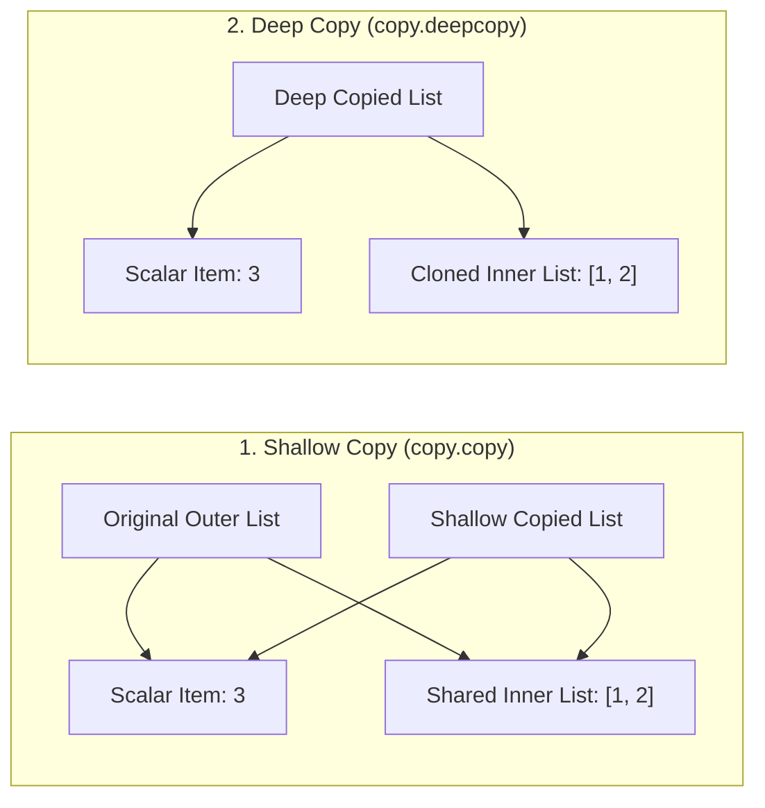

[← Back to Tech-21: Python Mastery & Internals Overview](./README.md) | [🏠 Series Catalog](../../README.md)

---

# 3. How Do Mutability, Shallow/Deep Copying, and the Mutable Default Argument Trap Work? 

## 1. The Core Concept & Intuition

Every data type in Python is classified as either **Immutable** or **Mutable**:
- **Immutable Types** (`int`, `float`, `str`, `tuple`, `frozenset`, `bytes`): Their internal state cannot be changed after instantiation. Any operation produces a brand-new object.
- **Mutable Types** (`list`, `dict`, `set`, `bytearray`, custom classes): Their in-place contents can be modified without changing their memory address (`id()`).

---

## 2. Under the Hood: Shallow Copy vs Deep Copy



- **Shallow Copy (`copy.copy()`, `list.copy()`, `[:]`)**: Creates a new outer collection, but inserts references to the exact same child objects.
- **Deep Copy (`copy.deepcopy()`)**: Recursively traverses the object graph, cloning all nested objects and collections from scratch.

| Operation | Copy Depth | Modification to Outer Container | Modification to Nested Mutable Objects |
| :--- | :--- | :--- | :--- |
| **Assignment (`b = a`)** | Zero copy (pointer alias) | Affects both (`a` and `b` share address) | Affects both (`a` and `b` identical) |
| **Shallow Copy (`copy.copy`)** | Top-level container only | Independent outer container | Shared nested references |
| **Deep Copy (`copy.deepcopy`)** | Recursive full object graph | Completely isolated | Completely isolated |

---

## 3. Clean Code in Action

### A. Default Mutable Argument Anti-Pattern vs Fix
In Python, **default arguments are evaluated ONCE when the function definition is executed (at import/load time)**, NOT every time the function is called:

```python
from typing import Optional, List

# SEVERE PRODUCTION BUG:
def append_to_bad(element: int, target_list: list[int] = []) -> list[int]:
    target_list.append(element)
    return target_list

print(append_to_bad(1))  # [1]
print(append_to_bad(2))  # [1, 2] ! (Shares the SAME list across invocations!)

# CORRECT & IDIOMATIC PYTHON 3.12+ PATTERN:
def append_to_safe(element: int, target_list: Optional[list[int]] = None) -> list[int]:
    if target_list is None:
        target_list = []  # Fresh list allocated per function call
    target_list.append(element)
    return target_list

print(append_to_safe(1))  # [1]
print(append_to_safe(2))  # [2]
```

### B. Shallow vs Deep Copy Mechanics
```python
import copy

# Nested data structure:
original: list[object] = [[1, 2], 3]

# 1. Shallow copy:
shallow_clone = copy.copy(original)
shallow_clone[0].append(99)  # Mutates the shared inner list!
print("Original after shallow mutation:", original)        # [[1, 2, 99], 3]
print("Shallow clone:", shallow_clone)                     # [[1, 2, 99], 3]

# 2. Deep copy:
isolated: list[object] = copy.deepcopy(original)
isolated[0].append(1000)     # Mutates strictly its own nested list
print("Original untouched:", original)                     # [[1, 2, 99], 3]
print("Deep clone isolated:", isolated)                    # [[1, 2, 99, 1000], 3]
```

---

## 4. Common Pitfalls & Interview Traps

| Trap / Misconception | Reality |
| :--- | :--- |
| **"Tuples are strictly immutable, so their contents can never change."** | A `tuple` is immutable regarding its own references (you cannot add, remove, or swap elements). However, if an element inside a tuple is a mutable object like a `list`, the inner list can be mutated in place (`t[0].append(99)`). |
| **"Using mutable objects (`[]` or `{}`) as default parameters."** | Python compiles default argument expressions once at function definition time, binding them to `func.__defaults__`. All calls omitting that argument share that exact object reference, leading to state leaks across requests. Always default to `None`. |

---

## 5. 60-Second Memory Anchor

> **"Default arguments are evaluated once at function definition time. Never use mutable objects (`[]` or `{}`) as default parameters—use `None` and initialize inside the function body. Use `copy.deepcopy()` to clone nested structures safely."**

---

[← Question 02](./02-everything-is-an-object-and-memory-model.md)

> ### 🎓 Looking for Questions 04 through 21 & Deep-Dive Appendices?
> You have reached the end of the free sampler for **Tech-21: Python Mastery & Internals**!
> 
> The full release contains **18 additional core interview chapters** plus **2 architectural reference appendices**, memory layouts, complete edge-case tables, and production patterns.
> 
> 📖 **[Get the Full Edition (Kindle / EPUB / PDF) →](./README.md#how-to-get-the-full-edition)**

