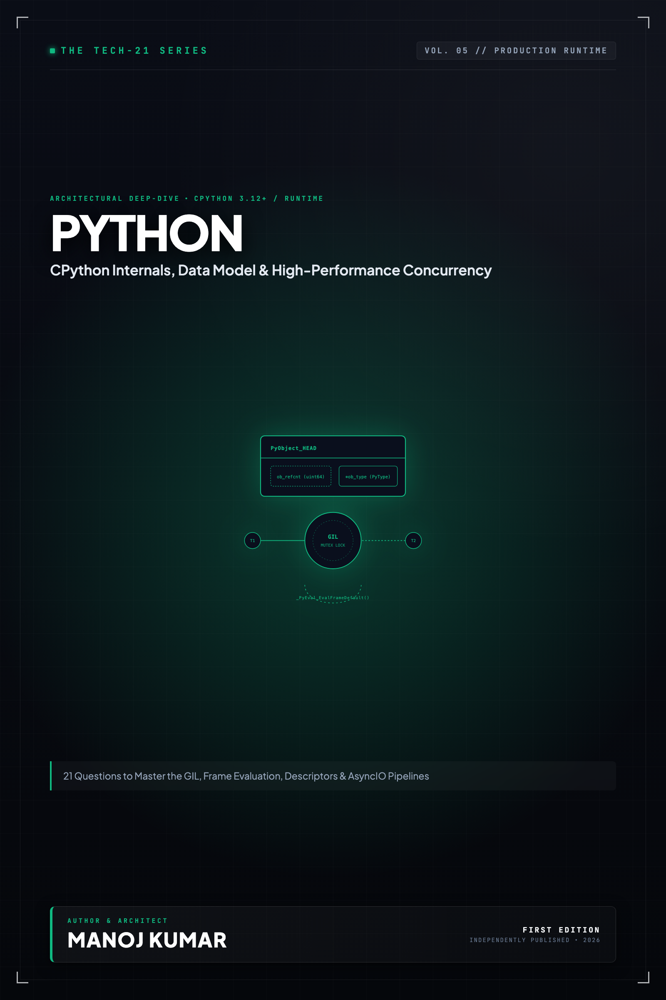

# Tech-21: Python Mastery & Internals

> **21 Questions to Master CPython Internals, the Data Model, Concurrency, and Modern Metaprogramming**  
> *Author: Manoj Kumar* • *Tech-21 Series (Vol. 05)*

  

## 📖 About This Edition

This repository contains the **free public sampler** for **Tech-21: Python Mastery & Internals**, including the **Preface and Questions 01 through 03** in their entirety. Every chapter follows the strict 5-section Tech-21 mental model framework:

1. **The Core Concept & Intuition** (High-signal problem statement & architecture)
2. **Under the Hood** (Runtime execution mechanics, memory diagrams, and comparison matrices)
3. **Clean Code in Action** (Idiomatic, production-grade implementations)
4. **Common Pitfalls & Interview Traps** (Structured bug-prevention matrices)
5. **60-Second Memory Anchor** (Permanent retention punchlines)

## 📋 Complete 21-Question Syllabus

| Chapter | Status | Title |
| :--- | :---: | :--- |
| **[00-preface](./00-preface.md)** | 🟢 **Free Sampler** | [Preface](./00-preface.md) |
| **[01-python-execution-model-and-cpython-internals](./01-python-execution-model-and-cpython-internals.md)** | 🟢 **Free Sampler** | [1. How Does the Python Execution Model and CPython Virtual Machine Work?](./01-python-execution-model-and-cpython-internals.md) |
| **[02-everything-is-an-object-and-memory-model](./02-everything-is-an-object-and-memory-model.md)** | 🟢 **Free Sampler** | [2. What Does 'Everything is an Object' Mean, and How Does the `PyObject` Memory Model Work?](./02-everything-is-an-object-and-memory-model.md) |
| **[03-mutability-copying-and-default-argument-traps](./03-mutability-copying-and-default-argument-traps.md)** | 🟢 **Free Sampler** | [3. How Do Mutability, Shallow/Deep Copying, and the Mutable Default Argument Trap Work?](./03-mutability-copying-and-default-argument-traps.md) |
| **04-variables-scopes-and-the-legb-rule** | 🔒 *Full Edition* | 4. How Do Variable Scopes, Namespaces, and the LEGB Lookup Rule Resolve Identifiers? |
| **05-functions-args-kwargs-and-first-class-citizens** | 🔒 *Full Edition* | 5. How Do Functions, First-Class Citizens, `*args`, `**kwargs`, and Parameter Rules Work? |
| **06-decorators-and-function-wrapping** | 🔒 *Full Edition* | 6. How Do Decorators, Closures, and Function Wrapping with `@wraps` Operate? |
| **07-the-global-interpreter-lock-gil** | 🔒 *Full Edition* | 7. What Is the Global Interpreter Lock (GIL), and How Does It Constrain Multi-Threaded Concurrency? |
| **08-memory-management-and-garbage-collection** | 🔒 *Full Edition* | 8. How Does Python Manage Memory Through Reference Counting and Generational Cyclic GC? |
| **09-oop-classes-and-the-method-resolution-order** | 🔒 *Full Edition* | 9. How Does Multiple Inheritance and the C3 Linearization Method Resolution Order (MRO) Work? |
| **10-dunder-methods-and-the-data-model** | 🔒 *Full Edition* | 10. How Does the Python Data Model Work with Dunder Methods and Structural Protocols? |
| **11-property-descriptors-and-attribute-access** | 🔒 *Full Edition* | 11. How Do Descriptors, `@property`, and the Attribute Lookup Chain Function Internally? |
| **12-iterators-iterables-and-generators** | 🔒 *Full Edition* | 12. How Do Iterators, Iterables, and Generator State Machines Work Under the Hood? |
| **13-context-managers-and-the-with-statement** | 🔒 *Full Edition* | 13. How Do Context Managers and the `with` Statement Protocol Ensure Resource Safety? |
| **14-concurrency-threading-multiprocessing-and-asyncio** | 🔒 *Full Edition* | 14. How Do Threading, Multiprocessing, and Asyncio Differ for CPU vs I/O-Bound Workloads? |
| **15-async-await-and-event-loops** | 🔒 *Full Edition* | 15. How Does Asynchronous Programming with `asyncio`, Coroutines, and TaskGroups Execute? |
| **16-type-hints-and-static-typing-with-mypy** | 🔒 *Full Edition* | 16. How Do Type Hints, Runtime Introspection, and Static Type Checking with Mypy Work? |
| **17-data-classes-pydantic-and-namedtuples** | 🔒 *Full Edition* | 17. How Do Data Classes, NamedTuples, and Pydantic Differ in Schema Validation and Performance? |
| **18-metaclasses-and-class-creation** | 🔒 *Full Edition* | 18. What Are Metaclasses, and How Do They Intercept Dynamic Class Creation? |
| **19-exception-hierarchy-and-custom-exceptions** | 🔒 *Full Edition* | 19. How Do the Exception Hierarchy, Exception Chaining, and Exception Groups Work? |
| **20-module-system-packages-and-imports** | 🔒 *Full Edition* | 20. How Does the Python Module Import System, `sys.modules`, and Package Discovery Work? |
| **21-profiling-and-performance-optimization** | 🔒 *Full Edition* | 21. How Do You Profile and Optimize Python Performance Using `cProfile`, `tracemalloc`, and `__slots__`? |
| **22-appendix-built-in-collections-complexity** | 🔒 *Full Edition* | Appendix A: Python Collections & Time Complexity Matrix |
| **23-appendix-dunder-methods-reference** | 🔒 *Full Edition* | Appendix B: Python Special (Dunder) Methods Reference |

---

## 🚀 How to Get the Full Edition

The complete edition unlocks **all 21 in-depth questions** and **both architectural reference appendices** (over 100+ pages of high-signal diagrams, memory layouts, and interview pitfall tables):

- 📱 **Kindle Edition**: Available on [Amazon Kindle](https://amazon.com)
- 📄 **Digital DRM-Free Bundle (EPUB + PDF)**: Instant download with high-res interior graphics
- 📦 **All-Access Pass**: Access all 15 volumes across the entire Tech-21 series

[← Return to Series Catalog](../../README.md)
