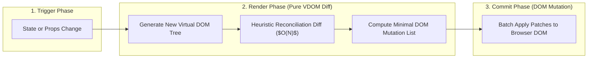

[← Back to Tech-21: React Core & Modern Architecture Overview](./README.md) | [🏠 Series Catalog](../../README.md)

---

# 1. What is React and How Does the Virtual DOM Work? 

## 1. The Core Concept & Intuition

Before React, web applications manipulated the browser's Document Object Model (DOM) imperatively using libraries like jQuery (`$('#user').text(name)`). In large applications, manual DOM manipulation quickly becomes unmaintainable, error-prone, and slow due to layout thrashing and forced browser reflows.

React pioneered **Declarative UI**: you describe what the UI *should look like* as a pure function of state ($UI = f(\text{State})$), and React handles synchronizing the real DOM efficiently behind the scenes. Developers write predictable component trees rather than tracking mutation transitions manually.

---

## 2. Under the Hood: The Virtual DOM & Reconciliation Pipeline

When state or props change, React invokes the component function to construct a new tree of plain JavaScript objects known as the **Virtual DOM**. React reconciles this new virtual tree against the previous fiber tree using an $O(N)$ heuristic diffing algorithm, calculating the minimum set of real DOM operations before flushing them in a batched commit phase.



| Dimension | Real DOM Operations | Virtual DOM (React) | Direct Reactive DOM (Signals / Svelte) |
| :--- | :--- | :--- | :--- |
| **Abstraction Level** | Low-level C++ browser DOM nodes | Lightweight in-memory JS object descriptors | Granular reactive dependency bindings |
| **Update Mechanism** | Imperative mutations (`node.appendChild`) | Diffing old vs new VDOM trees | Direct DOM element surgical updates |
| **Memory Footprint** | Heavy browser memory overhead | Retains two fiber trees in memory | Minimal (no intermediate virtual tree) |
| **Primary Value** | Peak theoretical speed when hand-tuned | **Declarative ergonomics** & batching | Fine-grained reactivity without VDOM |

---

## 3. Clean Code in Action

### A. Declarative Component Rendering
```jsx
import React, { useState } from 'react';

export function UserCard({ username, role }) {
  const [isOnline, setIsOnline] = useState(true);

  return (
    <div className={`card ${isOnline ? 'active' : 'offline'}`}>
      <h3>{username}</h3>
      <p>Role: {role}</p>
      <button onClick={() => setIsOnline(prev => !prev)}>
        Toggle Status: {isOnline ? 'Online' : 'Offline'}
      </button>
    </div>
  );
}
```

### B. JSX Transpilation Under the Modern JSX Transform
Under the modern `react/jsx-runtime` transform, JSX compiles into function calls without requiring `import React from 'react'`:

```jsx
// Source JSX:
export function Badge({ count }) {
  return <span className="badge">{count}</span>;
}

// Emitted JavaScript (Compiled by Vite / SWC):
import { jsx as _jsx } from "react/jsx-runtime";

export function Badge({ count }) {
  return _jsx("span", {
    className: "badge",
    children: count
  });
}
```

---

## 4. Common Pitfalls & Interview Traps

| Trap / Misconception | Reality |
| :--- | :--- |
| **"The Virtual DOM is faster than real DOM manipulation."** | The Virtual DOM is **not** faster than raw handcrafted, optimal DOM operations. Its primary benefit is **declarative ergonomics and predictable updates**, not absolute peak throughput. |
| **"JSX compiles directly in the browser without build tools."** | Browsers cannot parse JSX syntax natively; it must be transpiled by a build tool (Vite, esbuild, SWC) into standard JS calls. |
| **"Every re-render updates the browser DOM."** | Re-rendering only executes the component function and compares VDOM trees. If the diff produces zero changes, the browser DOM is never touched. |
| **"Rendering is always synchronous in React."** | In React 18+, Concurrent Features allow React to yield execution back to the browser during long render passes. |

---

## 5. 60-Second Memory Anchor

> **"React is a declarative UI library ($UI = f(\text{state})$). It maintains an in-memory Virtual DOM tree, computes minimal changes via reconciliation diffing, and batches DOM mutations to avoid unnecessary browser layout reflows."**

---

[← Preface](./00-preface.md) | **Next**: [Question 02 →](./02-the-react-fiber-architecture.md)
