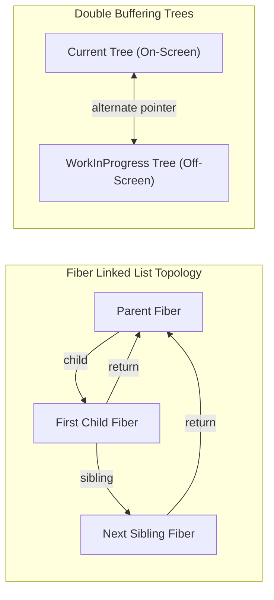

[← Back to Tech-21: React Core & Modern Architecture Overview](./README.md) | [🏠 Series Catalog](../../README.md)

---

# 2. How Does the React Fiber Architecture Drive the WorkLoop and Reconciliation? 

## 1. The Core Concept & Intuition

In React 15 (the legacy Stack Reconciler), reconciliation was a recursive, synchronous operation tied to JavaScript's native execution call stack. Once React began rendering a large component tree, it monopolized the main JavaScript thread until completion, causing dropped animation frames and unresponsive input fields ("jank").

In React 16+, React was completely re-architected around **Fiber**—a virtual call stack reimplementation built as a linked list of work units. Fiber enables **incremental, interruptible rendering, priority scheduling, and concurrent multitasking**.

---

## 2. Under the Hood: The Fiber Data Structure & Double Buffering

A **Fiber** is a plain JavaScript object representing a unit of work. Fibers link to one another using three core pointers: `child` (first immediate child), `sibling` (next adjacent child), and `return` (parent fiber). 

React maintains two simultaneous trees: the **`current`** tree (displayed on screen) and the **`workInProgress`** tree (constructed off-screen during the render phase). Once the work-in-progress tree is completed, React swaps the root pointer in a single pointer swap operation (**Double Buffering**), preventing visual UI tearing.



| Dimension | Legacy Stack Reconciler (React 15) | Modern Fiber Reconciler (React 16+) |
| :--- | :--- | :--- |
| **Execution Model** | Recursive, synchronous stack traversal | Incremental, interruptible `workLoopConcurrent` |
| **Thread Yielding** | Monopolizes main thread until completion | Yields control via browser micro-deadlines |
| **Task Prioritization** | All updates treated with equal urgency | Lane-based prioritization (User input vs Background) |
| **State Representation** | Ephemeral call stack frames | Persistent heap-allocated Fiber nodes and linked lists |
| **Concurrency & Suspense** | Impossible | First-class native engine primitive |

---

## 3. Clean Code in Action

### A. The Fiber Hook Linked List Architecture
How React stores multiple hooks sequentially inside a Fiber node's `memoizedState`:

```javascript
// Internal representation of Fiber memoizedState linked list:
const fiberNode = {
  type: UserProfile,
  memoizedState: {
    memoizedState: "Alice",     // Hook 1: useState("Alice")
    next: {
      memoizedState: 30,        // Hook 2: useState(30)
      next: {
        // Hook 3: useEffect
        memoizedState: { tag: 8, create: () => {} },
        next: null
      }
    }
  }
};
```

### B. Cooperative Scheduling with `workLoopConcurrent`

```javascript
// Simplified mental model of React's Concurrent WorkLoop:
function workLoopConcurrent() {
  // Yield execution to the browser if the 5ms frame slice expires
  while (workInProgress !== null && !shouldYieldToHost()) {
    performUnitOfWork(workInProgress);
  }
}
```

---

## 4. Common Pitfalls & Interview Traps

| Trap / Misconception | Reality |
| :--- | :--- |
| **"Hooks can be invoked inside `if` statements or loops."** | Hooks rely on monotonic index position in the Fiber node's `memoizedState.next` linked list. Calling a hook conditionally shifts pointers, corrupting all downstream state. |
| **"The Commit phase can be paused by higher-priority work."** | Only the Render/Reconciliation phase is interruptible. The Commit phase must execute synchronously to prevent partial DOM painting. |
| **"Fiber creates a new DOM node for every fiber."** | Fibers represent logical components. Only host fibers (`div`, `span`) map to concrete browser DOM nodes. |
| **"`shouldYieldToHost` uses `requestIdleCallback`."** | React uses `MessageChannel` and `performance.now()` under the hood because `requestIdleCallback` is too coarse-grained and throttled in background tabs. |

---

## 5. 60-Second Memory Anchor

> **"React Fiber replaces the synchronous call stack with a singly-linked list of Fiber units. Its interruptible Render phase computes diffs concurrently, while its synchronous Commit phase applies changes to the real DOM without visual tearing."**

---

[← Question 01](./01-what-is-react-and-the-virtual-dom.md) | **Next**: [Question 03 →](./03-components-props-and-pure-functions.md)
