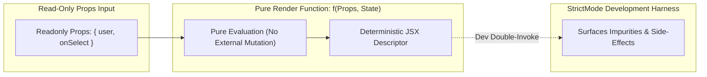

[← Back to Tech-21: React Core & Modern Architecture Overview](./README.md) | [🏠 Series Catalog](../../README.md)

---

# 3. How Do Components, Props, and Pure Functions Ensure Deterministic Rendering? 

## 1. The Core Concept & Intuition

In modern React, components are **pure JavaScript functions** that accept an input object called **Props** and return a description of the UI (JSX).

A core principle of React is that **components must be Pure Functions with respect to their props and render phase**:
- Given the same props and state, a component must **always return the exact same JSX tree**.
- Rendering must produce **zero observable side effects** (no mutating external variables, no timers, no network requests during the render phase).

---

## 2. Under the Hood: Prop Immutability and React's StrictMode

In development mode, React wraps components inside `<React.StrictMode>`, which intentionally double-invokes component render functions and initializers. This intentional double-pass flushes out hidden side-effects, such as mutating global variables, modifying props in-place, or reading from unpredictable external stores during rendering.



| Dimension | Pure Rendering (Idiomatic) | Impure Rendering (Anti-Pattern) | Event Handlers & Effects |
| :--- | :--- | :--- | :--- |
| **Execution Timing** | During Render Phase | During Render Phase | Post-Commit or User Triggered |
| **Allowed Operations** | Transforming inputs into JSX | Mutating global variables, updating DOM | Network requests, timers, DOM queries |
| **Concurrency Safe** | ✅ Can be paused or re-run safely | ❌ Causes data corruption and UI desync | ✅ Executes safely after state settles |
| **StrictMode Behavior** | Identical output on both runs | Divergent output / duplicate counts | Cleaned up via disposal callbacks |

---

## 3. Clean Code in Action

### A. Idiomatic Component Design with TypeScript & Children

```tsx
import React, { ReactNode } from 'react';

interface ContainerProps {
  title: string;
  badgeCount?: number;
  children: ReactNode;
}

export function SectionCard({ title, badgeCount = 0, children }: ContainerProps) {
  return (
    <section className="card-container">
      <header className="card-header">
        <h2>{title}</h2>
        {badgeCount > 0 && <span className="badge">{badgeCount}</span>}
      </header>
      <div className="card-body">{children}</div>
    </section>
  );
}
```

### B. Functional Derivation Over Impure Mutations

```jsx
// ✅ Clean: Compute derived values purely within the render pass
export function FilteredUserList({ users, filterText }) {
  // Pure derivation: No mutation of props or external arrays
  const filteredUsers = users.filter(user => 
    user.name.toLowerCase().includes(filterText.toLowerCase())
  );

  return (
    <ul>
      {filteredUsers.map(user => (
        <li key={user.id}>{user.name}</li>
      ))}
    </ul>
  );
}
```

---

## 4. Common Pitfalls & Interview Traps

| Trap / Misconception | Reality |
| :--- | :--- |
| **"Props can be mutated directly before passing downstream."** | Props are strictly read-only. Mutating `props.data.count++` silently breaks change detection and invalidates memoization caches. |
| **"Mutating a module-level variable during render is safe."** | Global variables mutated during render will corrupt state under React's Concurrent Mode when renders are aborted or repeated. |
| **"`StrictMode` double-renders components in production."** | Double-rendering occurs exclusively in development mode (`process.env.NODE_ENV !== 'production'`) to audit purity. |
| **"All functions inside components must be pure."** | Event handler functions (`onClick`, `onSubmit`) are impure by design; purity constraints apply strictly to the component's render execution body. |

---

## 5. 60-Second Memory Anchor

> **"React components must be pure functions of props and state. Props are strictly read-only; never mutate them. Any side effects (API calls, timers, subscriptions) must be isolated inside `useEffect` or event handlers."**

---

[← Question 02](./02-the-react-fiber-architecture.md)

> ### 🎓 Looking for Questions 04 through 21 & Deep-Dive Appendices?
> You have reached the end of the free sampler for **Tech-21: React Core & Modern Architecture**!
> 
> The full release contains **18 additional core interview chapters** plus **2 architectural reference appendices**, memory layouts, complete edge-case tables, and production patterns.
> 
> 📖 **[Get the Full Edition (Kindle / EPUB / PDF) →](./README.md#how-to-get-the-full-edition)**

