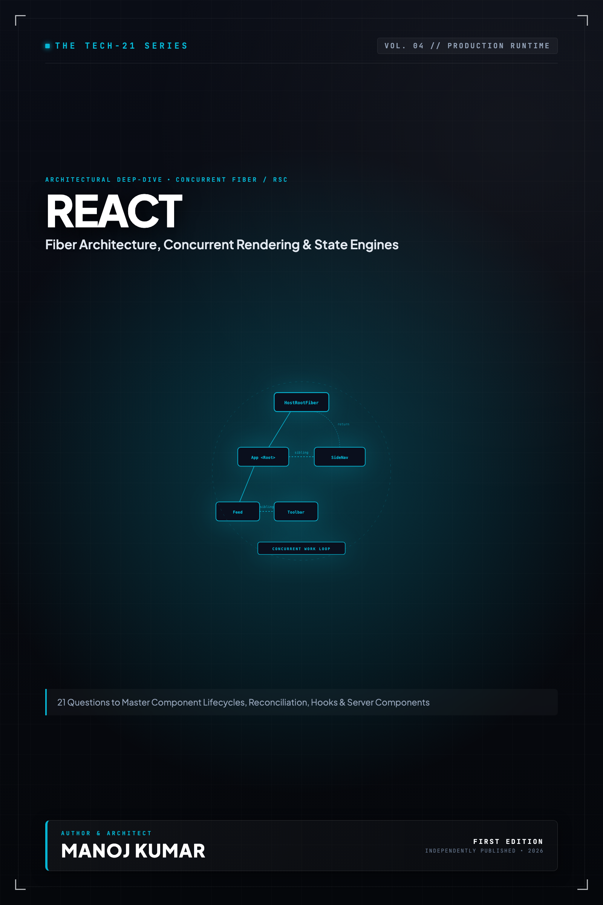

# Tech-21: React Core & Modern Architecture

> **21 Questions to Master Component Architecture, Fiber Internals, Hooks, and Concurrent Rendering**  
> *Author: Manoj Kumar* • *Tech-21 Series (Vol. 04)*

  

## 📖 About This Edition

This repository contains the **free public sampler** for **Tech-21: React Core & Modern Architecture**, including the **Preface and Questions 01 through 03** in their entirety. Every chapter follows the strict 5-section Tech-21 mental model framework:

1. **The Core Concept & Intuition** (High-signal problem statement & architecture)
2. **Under the Hood** (Runtime execution mechanics, memory diagrams, and comparison matrices)
3. **Clean Code in Action** (Idiomatic, production-grade implementations)
4. **Common Pitfalls & Interview Traps** (Structured bug-prevention matrices)
5. **60-Second Memory Anchor** (Permanent retention punchlines)

## 📋 Complete 21-Question Syllabus

| Chapter | Status | Title |
| :--- | :---: | :--- |
| **[00-preface](./00-preface.md)** | 🟢 **Free Sampler** | [Preface](./00-preface.md) |
| **[01-what-is-react-and-the-virtual-dom](./01-what-is-react-and-the-virtual-dom.md)** | 🟢 **Free Sampler** | [1. What is React and How Does the Virtual DOM Work?](./01-what-is-react-and-the-virtual-dom.md) |
| **[02-the-react-fiber-architecture](./02-the-react-fiber-architecture.md)** | 🟢 **Free Sampler** | [2. How Does the React Fiber Architecture Drive the WorkLoop and Reconciliation?](./02-the-react-fiber-architecture.md) |
| **[03-components-props-and-pure-functions](./03-components-props-and-pure-functions.md)** | 🟢 **Free Sampler** | [3. How Do Components, Props, and Pure Functions Ensure Deterministic Rendering?](./03-components-props-and-pure-functions.md) |
| **04-state-and-the-usestate-hook** | 🔒 *Full Edition* | 4. How Does `useState` Manage Component State, Automatic Batching, and Functional Updates? |
| **05-the-useeffect-lifecycle-and-cleanup** | 🔒 *Full Edition* | 5. How Does the `useEffect` Lifecycle, Dependency Array, and Cleanup Mechanics Work? |
| **06-useref-and-dom-manipulation** | 🔒 *Full Edition* | 6. How Does `useRef` Persist Mutable References and Interact with the DOM Without Re-rendering? |
| **07-usememo-and-usecallback-optimization** | 🔒 *Full Edition* | 7. When and How Should You Optimize Performance with `useMemo`, `useCallback`, and `React.memo`? |
| **08-the-usereducer-hook-and-state-machines** | 🔒 *Full Edition* | 8. How Does `useReducer` Model Complex State Transitions and State Machines? |
| **09-context-api-and-prop-drilling** | 🔒 *Full Edition* | 9. How Does the Context API Prevent Prop Drilling and When Does It Trigger Cascade Re-renders? |
| **10-custom-hooks-and-logic-reuse** | 🔒 *Full Edition* | 10. How Do Custom Hooks Encapsulate Stateful Logic and Enable Headless UI Reuse? |
| **11-controlled-vs-uncontrolled-components** | 🔒 *Full Edition* | 11. How Do Controlled and Uncontrolled Components Differ in Form Handling Architecture? |
| **12-error-boundaries-and-resilience** | 🔒 *Full Edition* | 12. How Do Error Boundaries Catch Rendering Failures and Architect Resilient UIs? |
| **13-code-splitting-lazy-and-suspense** | 🔒 *Full Edition* | 13. How Do `React.lazy` and `<Suspense>` Orchestrate Code Splitting and Asynchronous Loading? |
| **14-react-18-concurrent-rendering** | 🔒 *Full Edition* | 14. How Does Concurrent Rendering in React 18 Work with `useTransition` and `useDeferredValue`? |
| **15-server-components-vs-client-components** | 🔒 *Full Edition* | 15. How Do React Server Components (RSC) Differ from Client Components Across the Network Boundary? |
| **16-the-use-hook-and-async-transitions** | 🔒 *Full Edition* | 16. How Do the `use()` Hook and Action Hooks Streamline Asynchronous Operations in React 19? |
| **17-state-management-ecosystem** | 🔒 *Full Edition* | 17. How Do Redux Toolkit, Zustand, and TanStack Query Differ Across Client and Server State? |
| **18-server-side-rendering-and-hydration** | 🔒 *Full Edition* | 18. How Do Server-Side Rendering (SSR), Streaming HTML, and Hydration Function Under the Hood? |
| **19-synthetic-event-system** | 🔒 *Full Edition* | 19. How Does React's SyntheticEvent System Implement Event Delegation at the Root? |
| **20-react-internals-keys-and-reconciliation** | 🔒 *Full Edition* | 20. Why Do Keys Matter in List Diffing, Reconciliation, and Identity Preservation? |
| **21-testing-and-profiling-react-apps** | 🔒 *Full Edition* | 21. How Do You Test and Profile React Applications Using React DevTools and Testing Library? |
| **22-appendix-hooks-rules-cheat-sheet** | 🔒 *Full Edition* | Appendix A: React Hooks Decision Matrix |
| **23-appendix-performance-checklist** | 🔒 *Full Edition* | Appendix B: React Performance Audit Checklist |

---

## 🚀 How to Get the Full Edition

The complete edition unlocks **all 21 in-depth questions** and **both architectural reference appendices** (over 100+ pages of high-signal diagrams, memory layouts, and interview pitfall tables):

- 📱 **Kindle Edition**: Available on [Amazon Kindle](https://amazon.com)
- 📄 **Digital DRM-Free Bundle (EPUB + PDF)**: Instant download with high-res interior graphics
- 📦 **All-Access Pass**: Access all 13 volumes across the entire Tech-21 series

[← Return to Series Catalog](../../README.md)
