[← Back to Tech-21: System Design & Distributed Systems Overview](./README.md) | [🏠 Series Catalog](../../README.md)

---

# 1. How Do You Structure a System Design Interview and Execute Back-of-the-Envelope Math? 

## 1. The Core Concept & Intuition

System design interviews and real-world architectural design reviews evaluate your ability to navigate ambiguity, establish clear boundaries, and justify engineering trade-offs under rigid production constraints. When presented with an open-ended prompt like *"Design a Global Video Streaming Platform"* or *"Architect a Real-Time Ride-Hailing Dispatcher"*, diving immediately into drawing distributed microservice boxes or choosing specific database engines guarantees failure.

Senior and principal engineers approach large-scale architecture through a repeatable **4-Stage Design Framework** anchored by **Back-of-the-Envelope Calculations**. Capacity estimations are not theoretical math exercises; they quantify the fundamental scale of the system—identifying whether a design is bound by network bandwidth, disk I/O, memory capacity, or write throughput—before a single component is selected.

---

## 2. Under the Hood: System Design Framework & Capacity Bounds

```mermaid
graph LR
    subgraph Phase1 ["Phase 1: Scope & Constraints (5 mins)"]
        FReq["Functional Requirements"]
        NFReq["Non-Functional SLAs (Availability, P99 Latency)"]
    end

    subgraph Phase2 ["Phase 2: Back-of-the-Envelope (5 mins)"]
        QPS["Throughput (Read / Write QPS)"]
        Storage["Storage & Memory Sizing (5-Year)"]
        Bandwidth["Network Egress / Ingress"]
    end

    subgraph Phase3 ["Phase 3: High-Level Architecture (15 mins)"]
        APIs["API Contracts (REST / gRPC)"]
        DataFlow["Core Component Topology & Storage Schemas"]
    end

    subgraph Phase4 ["Phase 4: Deep Dive & Resiliency (20 mins)"]
        Bottlenecks["Bottlenecks, Partitioning & SPOF Mitigation"]
        Failover["Caches, Replicas & Circuit Breakers"]
    end

    Phase1 --> Phase2
    Phase2 --> Phase3
    Phase3 --> Phase4
```



### The 4 Execution Phases

1. **Clarify Scope and SLA Constraints (5 Mins)**: Define 2–3 core user workflows. Establish hard non-functional bounds: availability target ($99.99\%$ vs $99.9\%$), P99 latency target ($<50\text{ms}$), read-to-write ratio, and data consistency models (strict linearizability vs eventual consistency).
2. **Back-of-the-Envelope Estimations (5 Mins)**: Quantify scale. Assume $1\text{ day} \approx 86,400\text{ seconds} \approx 10^5\text{ seconds}$ for mental math. Calculate average QPS, peak QPS ($2\times\text{ to }5\times$), 5-year storage growth, and network egress bandwidth.
3. **High-Level Design (15 Mins)**: Sketch core API endpoints, data models, and macro services (API Gateway, Stateless Compute, Distributed Cache, Primary/Replica DB, Object Store). Walk through the end-to-end read and write lifecycle.
4. **Deep Dive & Bottlenecks (20 Mins)**: Address the critical system-specific bottleneck identified in Phase 2: data partitioning/sharding, consistent hashing, replication lag, hot key isolation, or cross-datacenter failover.

### Distributed Capacity Bounds & Scale Matrix

| Resource Dimension | Standard Commodity Node Limit | Scaling Threshold Trigger | Primary Mitigation Architecture |
| :--- | :--- | :--- | :--- |
| **Write QPS** | 1,000–10,000 writes/sec (RDBMS WAL limit) | $>10,000$ writes/sec | Horizontal sharding, LSM-tree engines (Cassandra), Kafka buffers |
| **Read QPS** | 20,000–50,000 reads/sec (DB buffer pool) | $>50,000$ reads/sec | Read replicas, Distributed In-Memory Cache (Redis/Memcached), CDNs |
| **Memory (RAM)** | 64 GB – 512 GB per server | Hot dataset exceeds single-node RAM | Distributed consistent hash cache cluster, LRU/LFU eviction |
| **Disk Storage** | 2 TB – 16 TB NVMe SSD per volume | $>10\text{ TB}$ 5-year data projection | Distributed Object Storage (S3), Columnar cold storage (Parquet/S3) |
| **Network Bandwidth**| 10 Gbps ($\approx 1.25\text{ GB/s}$) NIC line rate | $>5\text{ Gbps}$ egress stream | Global CDN Edge Caching, chunked media streaming, gzip/zstd |

---

## 3. Clean Code in Action

### A. Production Capacity Estimator & Traffic Sizer (Python)

```python
# capacity_planner.py
# Production capacity planner for automated system design estimations
from dataclasses import dataclass

@dataclass(frozen=True)
class CapacityMetrics:
    avg_write_qps: float
    peak_write_qps: float
    avg_read_qps: float
    peak_read_qps: float
    daily_storage_gb: float
    five_year_storage_tb: float
    network_egress_mbps: float

def calculate_system_capacity(
    dau: int,
    reads_per_user_day: int,
    writes_per_user_day: int,
    read_payload_bytes: int,
    write_payload_bytes: int,
    peak_multiplier: float = 3.0,
) -> CapacityMetrics:
    """Calculates QPS, 5-year storage, and network egress using
    standard bounds."""
    SECONDS_PER_DAY = 86_400

    total_writes_day = dau * writes_per_user_day
    total_reads_day = dau * reads_per_user_day

    avg_write_qps = total_writes_day / SECONDS_PER_DAY
    peak_write_qps = avg_write_qps * peak_multiplier

    avg_read_qps = total_reads_day / SECONDS_PER_DAY
    peak_read_qps = avg_read_qps * peak_multiplier

    daily_storage_bytes = total_writes_day * write_payload_bytes
    daily_storage_gb = daily_storage_bytes / (1024**3)
    five_year_storage_tb = (daily_storage_bytes * 365 * 5) / (1024**4)

    # Egress bandwidth in Megabits per second (Mbps)
    peak_egress_bytes_sec = peak_read_qps * read_payload_bytes
    network_egress_mbps = (peak_egress_bytes_sec * 8) / 1_000_000

    return CapacityMetrics(
        avg_write_qps=round(avg_write_qps, 2),
        peak_write_qps=round(peak_write_qps, 2),
        avg_read_qps=round(avg_read_qps, 2),
        peak_read_qps=round(peak_read_qps, 2),
        daily_storage_gb=round(daily_storage_gb, 2),
        five_year_storage_tb=round(five_year_storage_tb, 2),
        network_egress_mbps=round(network_egress_mbps, 2),
    )

# Sizing a Twitter/X scale service: 200M DAU, 2 tweets/day, 50 feed
# reads/day
plan = calculate_system_capacity(
    dau=200_000_000,
    reads_per_user_day=50,
    writes_per_user_day=2,
    read_payload_bytes=2_000,   # 2 KB per tweet payload
    write_payload_bytes=1_000,  # 1 KB text + metadata
)
print(f"Peak Read QPS: {plan.peak_read_qps:,.0f} req/s")
print(f"5-Year Storage: {plan.five_year_storage_tb:,.1f} TB")
print(f"Peak Egress:    {plan.network_egress_mbps:,.1f} Mbps")
```

### B. Dynamic Hardware Tier Sizing Engine (TypeScript)

```typescript
// hardwareSizer.ts
// Computes cluster instance sizing based on memory cache and write
// IOPS limits
interface ClusterProfile {
  cacheNodesRequired: number;
  dbShardsRequired: number;
  readReplicasRequired: number;
}

export function computeClusterTopology(
  peakReadQps: number,
  peakWriteQps: number,
  dailyActiveWorkingSetGb: number,
  ramPerCacheNodeGb: number = 64,
  maxIopsPerShard: number = 5000,
  maxQpsPerReplica: number = 10000
): ClusterProfile {
  // 80/20 Rule: Cache 20% of the most active working set in RAM
  const cacheWorkingSetRamGb = dailyActiveWorkingSetGb * 0.20;
  // 75% max memory headroom
  const cacheNodesRequired = Math.ceil(
    cacheWorkingSetRamGb / (ramPerCacheNodeGb * 0.75)
  );

  // DB write throughput determines horizontal sharding count
  const dbShardsRequired = Math.max(
    1, Math.ceil(peakWriteQps / maxIopsPerShard)
  );

  // Remaining read load after 90% cache-hit ratio
  const unhitReadQps = peakReadQps * 0.10;
  const readReplicasRequired = Math.max(
    1, Math.ceil(unhitReadQps / maxQpsPerReplica)
  );

  return {
    cacheNodesRequired,
    dbShardsRequired,
    readReplicasRequired,
  };
}
```

---

## 4. Common Pitfalls & Interview Traps

| Trap / Misconception | Reality |
| :--- | :--- |
| **"Over-optimizing calculations to exact decimal places"** | Back-of-the-envelope estimation is meant to establish **orders of magnitude** ($10^3$ vs $10^6$ QPS). Spending interview time doing long division signals a lack of senior prioritization. Round aggressively ($86,400\text{ sec} \to 10^5\text{ sec}$). |
| **"Designing before clarifying read-to-write ratios"** | A 100:1 read-heavy system requires extensive CDN edge caching, Redis read clusters, and read-replica fan-out. A 1:1 write-heavy system requires message streaming buffers (Kafka) and log-structured storage engines (Cassandra/ScyllaDB). |
| **"Ignoring peak traffic multipliers"** | Designing for average QPS leaves the system vulnerable to instant collapse during traffic spikes (Black Friday, breaking news). Always apply a $2\times\text{ to }5\times$ peak multiplier to dimension load balancers and compute tiers. |

---

## 5. 60-Second Memory Anchor

> **"Never architect in the dark: clarify non-functional SLA bounds first, use $10^5$ seconds/day to rapidly estimate peak QPS and 5-year storage, and let the read-to-write ratio dictate your caching and database sharding strategy."**

---

[← Preface](./00-preface.md) | **Next**: [Question 02 →](./02-scalability-horizontal-vs-vertical-and-statelessness.md)
