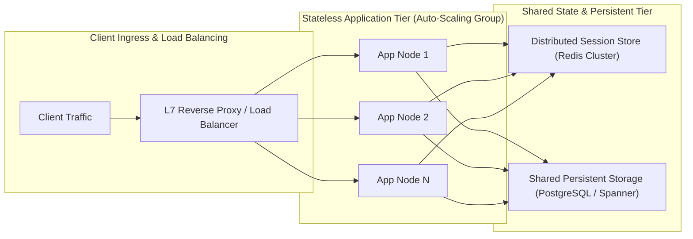

[← Back to Tech-21: System Design & Distributed Systems Overview](./README.md) | [🏠 Series Catalog](../../README.md)

---

# 2. How Do Horizontal and Vertical Scaling Differ, and Why Is Stateless Architecture Essential? 

## 1. The Core Concept & Intuition

When a software system experiences increasing concurrent traffic and expanding data volume, it must scale to preserve its latency SLAs and prevent service collapse. 

Architects face two foundational paths for scaling:
1. **Vertical Scaling (Scale-Up)**: Upgrading a single server with more CPU cores, larger RAM capacity, and faster NVMe solid-state storage.
2. **Horizontal Scaling (Scale-Out)**: Distributing incoming traffic across a dynamic pool of commodity compute instances orchestrated behind a load balancer.

While vertical scaling appears frictionless because it requires zero architectural changes to monolithic codebases, it hits hard physical hardware limits and introduces a catastrophic single point of failure (SPOF). Horizontal scaling provides theoretically unbounded elasticity, but it demands an uncompromising architectural prerequisite: **stateless compute tiers**.

---

## 2. Under the Hood: Scaling Dimensions & Stateless Tier Architecture



### The Architectural Necessity of Statelessness

If an application server stores user session data, in-flight cart state, or authentication context in local process memory, that server becomes **stateful**. Every subsequent HTTP request from that user must be routed back to the exact same physical server via load balancer **Sticky Sessions (Session Affinity)**.

Sticky sessions create catastrophic production failure modes:
- **Server Crash & State Destruction**: If server $S_1$ crashes, all active users pinned to $S_1$ lose their session state and get logged out.
- **Traffic Hotspots**: If multiple high-traffic power users or corporate proxy IPs map to the same node, that server saturates while neighboring nodes remain idle.
- **Blocked Rolling Deploys**: Deploying new code or scaling down instances during off-peak hours drains sessions slowly or disrupts active transactions.

In a **Stateless Architecture**, every compute instance is disposable and identical. State is externalized into an ultra-fast in-memory cluster (**Redis Cluster**) or encoded directly into cryptographically verified tokens (**JWTs**). Any server in the fleet can process any incoming request from any client at any microsecond.

### Scaling Dimension Trade-Off Matrix

| Architectural Dimension | Vertical Scaling (Scale-Up) | Horizontal Scaling (Scale-Out) |
| :--- | :--- | :--- |
| **Capacity Limit** | Hard physical limit (e.g. 128 cores, 4 TB RAM) | Theoretically unlimited; add commodity nodes |
| **High Availability & SPOF** | Yes; single hardware failure terminates system | No; multi-node redundancy tolerates individual node loss |
| **Cost Trajectory** | Exponential (specialized enterprise hardware is costly)| Linear (commodity cloud instances and Spot VMs) |
| **Deployment Model** | Requires maintenance downtime for hardware resize | Zero-downtime rolling deploys and dynamic HPA autoscaling |
| **Architectural Overhead**| Zero; single machine manages all threads and memory | Requires external distributed session caching and routing |

---

## 3. Clean Code in Action

### A. Production Stateless Session Middleware (Go)

```go
// session_middleware.go
// Production HTTP middleware enforcing stateless request handling via
// Redis session tokens
package main

import (
	"context"
	"crypto/rand"
	"encoding/hex"
	"net/http"
	"time"

	"github.com/redis/go-redis/v9"
)

type SessionManager struct {
	client *redis.Client
	ttl    time.Duration
}

func NewSessionManager(
	client *redis.Client, ttl time.Duration,
) *SessionManager {
	return &SessionManager{client: client, ttl: ttl}
}

// GenerateSession creates an externalized session token stored
// centrally in Redis
func (sm *SessionManager) GenerateSession(
	ctx context.Context, userID string,
) (string, error) {
	bytes := make([]byte, 32)
	if _, err := rand.Read(bytes); err != nil {
		return "", err
	}
	token := hex.EncodeToString(bytes)

	// Persist session in Redis; independent of the host that processed
	// this request
	err := sm.client.Set(ctx, "session:"+token, userID, sm.ttl).Err()
	return token, err
}

// Middleware validates session on ANY stateless server node
func (sm *SessionManager) Middleware(next http.Handler) http.Handler {
	return http.HandlerFunc(
		func(w http.ResponseWriter, r *http.Request) {
		cookie, err := r.Cookie("session_token")
		if err != nil {
			http.Error(
				w, "Unauthorized: missing session",
				http.StatusUnauthorized,
			)
			return
		}

		// Lookup state from shared cache cluster
		key := "session:" + cookie.Value
		userID, err := sm.client.Get(r.Context(), key).Result()
		if err == redis.Nil {
			http.Error(
				w, "Unauthorized: expired session",
				http.StatusUnauthorized,
			)
			return
		} else if err != nil {
			http.Error(
				w, "Internal Server Error",
				http.StatusInternalServerError,
			)
			return
		}

		// Inject user identity into request context for stateless handlers
		ctx := context.WithValue(r.Context(), "user_id", userID)
		next.ServeHTTP(w, r.WithContext(ctx))
	})
}
```

### B. Declarative Horizontal Pod Autoscaler (Kubernetes YAML)

```yaml
# hpa-stateless-service.yaml
# Production autoscaling configuration based on CPU and request
# latency metrics
apiVersion: autoscaling/v2
kind: HorizontalPodAutoscaler
metadata:
  name: stateless-order-service-hpa
  namespace: production
spec:
  scaleTargetRef:
    apiVersion: apps/v1
    kind: Deployment
    name: stateless-order-service
  minReplicas: 5
  maxReplicas: 50
  metrics:
    - type: Resource
      resource:
        name: cpu
        target:
          type: Utilization
          averageUtilization: 65
    - type: Pods
      pods:
        metric:
          name: http_requests_per_second
        target:
          type: AverageValue
          averageValue: "1500m"
  behavior:
    scaleUp:
      stabilizationWindowSeconds: 0
      policies:
        - type: Percent
          value: 100
          periodSeconds: 15
    scaleDown:
      # Prevent flapping during transient dips
      stabilizationWindowSeconds: 300
      policies:
        - type: Percent
          value: 10
          periodSeconds: 60
```

---

## 4. Common Pitfalls & Interview Traps

| Trap / Misconception | Reality |
| :--- | :--- |
| **"Sticky Sessions as a quick fix for horizontal scale"** | Session affinity pins clients to specific servers, defeating autoscaling. It causes acute traffic hotspots when popular users saturate single nodes and breaks seamless rolling updates. Externalize state to Redis or use cryptographic JWTs. |
| **"Assuming compute statelessness solves database scale"** | Making application servers stateless does not magically scale the database. State is simply moved downstream to the data tier, which quickly becomes the bottleneck unless sharding, read-replicas, and caching are introduced. |
| **"Single Redis instance as session store"** | Centralizing sessions into a single standalone Redis node replaces server SPOF with a single data SPOF. Session caching must use Redis Sentinel or Redis Cluster with multi-AZ replication. |

---

## 5. 60-Second Memory Anchor

> **"Vertical scaling hits hard physical cost and capacity ceilings. True horizontal elasticity requires completely stateless compute nodes that externalize session state to distributed cache clusters, enabling frictionless auto-scaling and zero-downtime rolling deploys."**

---

[← Question 01](./01-high-level-framework-and-back-of-the-envelope-calculations.md) | **Next**: [Question 03 →](./03-load-balancing-algorithms-and-reverse-proxies.md)
