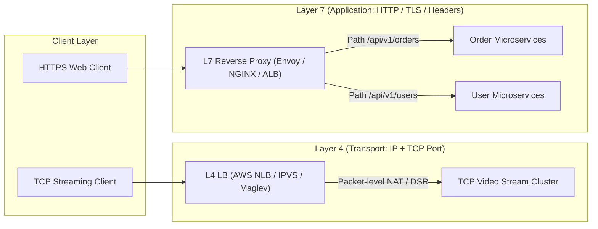

[← Back to Tech-21: System Design & Distributed Systems Overview](./README.md) | [🏠 Series Catalog](../../README.md)

---

# 3. How Do Load Balancing Algorithms and Reverse Proxies Distribute High-Volume Traffic? 

## 1. The Core Concept & Intuition

A **Load Balancer (LB)** sits between client devices and backend application clusters, intercepting incoming network traffic and distributing requests across a pool of healthy instances to maximize throughput, minimize response latency, and avoid overloading any individual node.

A **Reverse Proxy** acts on behalf of backend application services—terminating client TCP connections and TLS handshakes, enforcing rate limits, inspecting HTTP headers, compressing responses (Gzip/Brotli), and routing requests to internal microservices based on URI paths.

In production architectures, load balancers and reverse proxies form the front gate of the infrastructure. Without intelligent distribution algorithms and resilient failover topologies, a cluster of a thousand servers can be brought to its knees by uneven traffic hotspots or cascading connection storms.

---

## 2. Under the Hood: L4 vs. L7 Load Balancing & Balancing Algorithms



### Layer 4 vs. Layer 7 Comparison

- **Layer 4 Load Balancing (Transport Layer)**: Routes traffic based purely on **IP addresses and TCP/UDP ports** without inspecting application payload. It uses packet manipulation (Network Address Translation or Direct Server Return). Because it terminates no TLS sessions and parses no HTTP payloads, it achieves wire-speed throughput with ultra-low CPU overhead.
- **Layer 7 Load Balancing (Application Layer)**: Terminates the client's TCP and TLS sessions, fully inspecting HTTP headers, cookies, query parameters, and JSON payloads. It enables smart path routing, sticky cookies, header mutations, and web application firewall (WAF) filtering at the cost of higher CPU consumption.

### Layer 4 vs. Layer 7 Architecture Matrix

| Architectural Dimension | Layer 4 Load Balancer (Transport) | Layer 7 Reverse Proxy (Application) |
| :--- | :--- | :--- |
| **OSI Layer** | Layer 4 (TCP, UDP, SCTP) | Layer 7 (HTTP/1.1, HTTP/2, gRPC, WebSocket) |
| **Data Inspection** | Headers up to TCP/UDP ports only | Full HTTP request headers, cookies, URL paths, body |
| **TLS/SSL Termination** | Pass-through (Client connects directly) | Full TLS termination and certificate management |
| **Routing Intelligence** | IP/Port hashing, Round Robin | URI path (`/api/v1/*`), header values, HTTP verbs |
| **Throughput & Latency**| Millions of packets/sec; sub-millisecond | Hundreds of thousands of req/sec; slight CPU parsing latency |
| **Canonical Technologies**| AWS NLB, Linux IPVS, Google Maglev, HAProxy (TCP) | Envoy Proxy, NGINX, HAProxy (HTTP), Traefik, AWS ALB |

### Core Load Balancing Algorithms

1. **Round Robin**: Distributes requests sequentially across all nodes. Best for homogeneous servers and uniform request durations.
2. **Weighted Round Robin**: Routes traffic proportionally based on static server capacity weights (e.g. 16-core server receives $4\times$ the traffic of a 4-core server).
3. **Least Connections**: Dispatches new requests to the server with the lowest count of active in-flight connections. Essential for long-lived WebSocket sessions or varying transaction durations.
4. **Weighted Least Response Time**: Combines active connection counts with rolling average server response latency, routing traffic to the fastest responsive nodes.
5. **IP / Client Hash**: Hashes the client IP to map requests consistently to the same server, often used for caching locality.

---

## 3. Clean Code in Action

### A. Production NGINX Reverse Proxy Configuration

```nginx
# nginx.conf
# Production L7 reverse proxy configuration with TLS termination, rate limiting, and upstreams
events {
    worker_connections 4096;
}

http {
    # Define rate limiting zone: 10MB memory, 100 requests per second per IP
    limit_req_zone $binary_remote_addr zone=api_limit:10m rate=100r/s;

    upstream order_microservice_cluster {
        # Weighted load balancing with passive health monitoring
        server order-svc-01.internal:8080 weight=3 max_fails=3 fail_timeout=10s;
        server order-svc-02.internal:8080 weight=2 max_fails=3 fail_timeout=10s;
        server order-svc-03.internal:8080 weight=1 max_fails=3 fail_timeout=10s;
        keepalive 64; # Connection pooling to backend upstreams
    }

    server {
        listen 443 ssl http2;
        server_name api.production.example.com;

        ssl_certificate     /etc/ssl/certs/api_bundle.crt;
        ssl_certificate_key /etc/ssl/private/api_bundle.key;
        ssl_protocols       TLSv1.2 TLSv1.3;
        ssl_ciphers         HIGH:!aNULL:!MD5;

        location /api/v1/orders {
            # Enforce rate limiting with burst buffer of 20 requests
            limit_req zone=api_limit burst=20 nodelay;

            proxy_pass http://order_microservice_cluster;
            proxy_http_version 1.1;
            proxy_set_header Connection "";
            proxy_set_header Host $host;
            proxy_set_header X-Real-IP $remote_addr;
            proxy_set_header X-Forwarded-For $proxy_add_x_forwarded_for;
            proxy_set_header X-Forwarded-Proto $scheme;

            # Failover thresholds
            proxy_connect_timeout 2s;
            proxy_read_timeout 5s;
        }
    }
}
```

### B. Smooth Weighted Round-Robin Balancing Algorithm (Go)

```go
// load_balancer.go
// Production implementation of NGINX-style Smooth Weighted Round-Robin balancing
package main

import (
	"fmt"
	"sync"
)

type ServerNode struct {
	Address         string
	Weight          int // Configured static weight
	CurrentWeight   int // Dynamically adjusted weight
	ActiveRequests  int
}

type SmoothWeightedBalancer struct {
	mu      sync.Mutex
	servers []*ServerNode
}

func NewSmoothWeightedBalancer(servers []*ServerNode) *SmoothWeightedBalancer {
	return &SmoothWeightedBalancer{servers: servers}
}

// Next selects the next server ensuring balanced distribution without burst clumps
func (b *SmoothWeightedBalancer) Next() (*ServerNode, error) {
	b.mu.Lock()
	defer b.mu.Unlock()

	if len(b.servers) == 0 {
		return nil, fmt.Errorf("no backend servers available")
	}

	totalWeight := 0
	var bestNode *ServerNode

	for _, node := range b.servers {
		totalWeight += node.Weight
		node.CurrentWeight += node.Weight

		if bestNode == nil || node.CurrentWeight > bestNode.CurrentWeight {
			bestNode = node
		}
	}

	// Deduct totalWeight from the winning node to smooth out future selections
	bestNode.CurrentWeight -= totalWeight
	return bestNode, nil
}

func main() {
	servers := []*ServerNode{
		{Address: "10.0.0.1:8080", Weight: 5},
		{Address: "10.0.0.2:8080", Weight: 2},
		{Address: "10.0.0.3:8080", Weight: 1},
	}
	balancer := NewSmoothWeightedBalancer(servers)

	// Simulate 8 incoming requests
	for i := 1; i <= 8; i++ {
		selected, _ := balancer.Next()
		fmt.Printf("Request #%d routed to: %s\n", i, selected.Address)
	}
}
```

---

## 4. Common Pitfalls & Interview Traps

| Trap / Misconception | Reality |
| :--- | :--- |
| **"The Load Balancer as a Single Point of Failure (SPOF)"** | Putting all backend servers behind a single load balancer instance replaces distributed risk with an acute bottleneck. Eliminate SPOF by clustering load balancers in an **Active-Passive pair using VRRP/Keepalived**, or deploy **Active-Active multi-IP load balancing via BGP Anycast and DNS Round Robin**. |
| **"Health Check Cascading Failure Storm"** | Aggressive health checks (probing backends every 500ms with a heavy SQL query) add significant load. When one backend slows down and fails checks, the balancer sheds its traffic to remaining nodes, overloading them and causing all backends to fail checks simultaneously. Use lightweight `/healthz` endpoints with exponential backoff. |
| **"Using Round Robin for long-lived WebSocket connections"** | Standard Round Robin assumes all requests complete in milliseconds. With persistent WebSockets or SSE streams, some servers accumulate thousands of long-running connections while others stay idle. Always use **Least Connections** for stateful or long-lived transport streams. |

---

## 5. 60-Second Memory Anchor

> **"Use Layer 4 balancers for ultra-fast TCP packet forwarding at wire speed, and Layer 7 reverse proxies for content-based HTTP routing, TLS termination, and rate limiting. Eliminate balancer SPOF using BGP Anycast or VRRP active-passive failover."**

---

[← Question 02](./02-scalability-horizontal-vs-vertical-and-statelessness.md)

> ### 🎓 Looking for Questions 04 through 21 & Deep-Dive Appendices?
> You have reached the end of the free sampler for **Tech-21: System Design & Distributed Systems**!
> 
> The full release contains **18 additional core interview chapters** plus **2 architectural reference appendices**, memory layouts, complete edge-case tables, and production patterns.
> 
> 📖 **[Get the Full Edition (Kindle / EPUB / PDF) →](./README.md#how-to-get-the-full-edition)**

