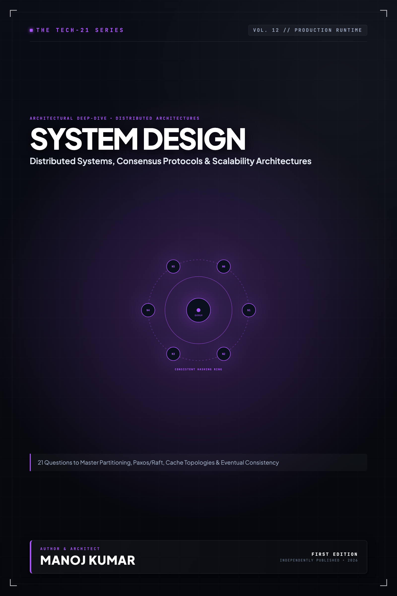

# Tech-21: System Design & Distributed Systems

> **21 Questions to Master Scalability, Fault Tolerance, Consensus, and Large-Scale Architecture**  
> *Author: Manoj Kumar* • *Tech-21 Series (Vol. 12)*

  

## 📖 About This Edition

This repository contains the **free public sampler** for **Tech-21: System Design & Distributed Systems**, including the **Preface and Questions 01 through 03** in their entirety. Every chapter follows the strict 5-section Tech-21 mental model framework:

1. **The Core Concept & Intuition** (High-signal problem statement & architecture)
2. **Under the Hood** (Runtime execution mechanics, memory diagrams, and comparison matrices)
3. **Clean Code in Action** (Idiomatic, production-grade implementations)
4. **Common Pitfalls & Interview Traps** (Structured bug-prevention matrices)
5. **60-Second Memory Anchor** (Permanent retention punchlines)

## 📋 Complete 21-Question Syllabus

| Chapter | Status | Title |
| :--- | :---: | :--- |
| **[00-preface](./00-preface.md)** | 🟢 **Free Sampler** | [Preface](./00-preface.md) |
| **[01-high-level-framework-and-back-of-the-envelope-calculations](./01-high-level-framework-and-back-of-the-envelope-calculations.md)** | 🟢 **Free Sampler** | [1. How Do You Structure a System Design Interview and Execute Back-of-the-Envelope Math?](./01-high-level-framework-and-back-of-the-envelope-calculations.md) |
| **[02-scalability-horizontal-vs-vertical-and-statelessness](./02-scalability-horizontal-vs-vertical-and-statelessness.md)** | 🟢 **Free Sampler** | [2. How Do Horizontal and Vertical Scaling Differ, and Why Is Stateless Architecture Essential?](./02-scalability-horizontal-vs-vertical-and-statelessness.md) |
| **[03-load-balancing-algorithms-and-reverse-proxies](./03-load-balancing-algorithms-and-reverse-proxies.md)** | 🟢 **Free Sampler** | [3. How Do Load Balancing Algorithms and Reverse Proxies Distribute High-Volume Traffic?](./03-load-balancing-algorithms-and-reverse-proxies.md) |
| **04-consistent-hashing-and-distributed-caching** | 🔒 *Full Edition* | 4. How Does Consistent Hashing Enable Resilient Distributed Caching and Partitioning? |
| **05-caching-strategies-and-cache-invalidation** | 🔒 *Full Edition* | 5. What Are Common Caching Topologies, and How Do You Solve the Cache Invalidation Problem? |
| **06-relational-vs-nosql-databases** | 🔒 *Full Edition* | 6. How Do Relational and NoSQL Databases Differ Across Data Models, Storage, and Queries? |
| **07-the-cap-theorem-and-pacelc** | 🔒 *Full Edition* | 7. How Do the CAP Theorem and PACELC Govern Distributed System Trade-Offs Under Partition? |
| **08-database-scaling-replication-and-sharding** | 🔒 *Full Edition* | 8. How Do Database Replication and Sharding Solve Scale and Performance Bottlenecks? |
| **09-acid-transactions-vs-base-eventual-consistency** | 🔒 *Full Edition* | 9. How Do Strong ACID Guarantees Differ from BASE Eventual Consistency in Distributed Systems? |
| **10-message-queues-and-event-driven-architecture** | 🔒 *Full Edition* | 10. How Do Message Queues and Event-Driven Architectures Decouple Asynchronous Workloads? |
| **11-event-sourcing-and-cqrs** | 🔒 *Full Edition* | 11. How Do Event Sourcing and CQRS Separate Write Commands from Scalable Read Views? |
| **12-distributed-transactions-2pc-and-saga-pattern** | 🔒 *Full Edition* | 12. How Do Two-Phase Commit (2PC) and the Saga Pattern Coordinate Distributed Transactions? |
| **13-distributed-locking-and-consensus-algorithms** | 🔒 *Full Edition* | 13. How Do Distributed Locks and Consensus Algorithms (Raft, Paxos) Prevent Split-Brain Failures? |
| **14-rate-limiting-and-traffic-shaping** | 🔒 *Full Edition* | 14. How Do Token Bucket, Leaky Bucket, and Sliding Window Algorithms Enforce API Rate Limiting? |
| **15-api-gateways-and-bff-architecture** | 🔒 *Full Edition* | 15. How Do API Gateways and the Backend-for-Frontend (BFF) Pattern Route and Protect Services? |
| **16-distributed-unique-id-generators** | 🔒 *Full Edition* | 16. How Do Distributed Unique ID Generators (Snowflake, UUIDv7) Generate Time-Ordered Keys? |
| **17-search-indexing-and-inverted-indexes** | 🔒 *Full Edition* | 17. How Do Inverted Indexes and Search Engines (Elasticsearch) Power Sub-Second Full-Text Queries? |
| **18-content-delivery-networks-cdn-and-edge-computing** | 🔒 *Full Edition* | 18. How Do CDNs and Edge Computing Minimize Latency and Protect Origin Servers? |
| **19-resilience-circuit-breakers-and-bulkheads** | 🔒 *Full Edition* | 19. How Do Circuit Breakers, Retries, and Bulkheads Prevent Cascading Distributed System Outages? |
| **20-observability-metrics-logs-and-distributed-tracing** | 🔒 *Full Edition* | 20. How Do Distributed Tracing, Structured Logging, and Metrics Form Complete System Observability? |
| **21-designing-a-real-world-system-url-shortener-to-scale** | 🔒 *Full Edition* | 21. How Do You Design a High-Scale URL Shortener (Bitly) from API to Global Storage? |
| **22-appendix-system-design-numbers-cheat-sheet** | 🔒 *Full Edition* | Appendix A: System Design Numbers Every Engineer Must Know |
| **23-appendix-architecture-patterns-matrix** | 🔒 *Full Edition* | Appendix B: Architecture Patterns & Trade-offs Matrix |

---

## 🚀 How to Get the Full Edition

The complete edition unlocks **all 21 in-depth questions** and **both architectural reference appendices** (over 100+ pages of high-signal diagrams, memory layouts, and interview pitfall tables):

- 📱 **Kindle Edition**: Available on [Amazon Kindle](https://amazon.com)
- 📄 **Digital DRM-Free Bundle (EPUB + PDF)**: Instant download with high-res interior graphics
- 📦 **All-Access Pass**: Access all 13 volumes across the entire Tech-21 series

[← Return to Series Catalog](../../README.md)
