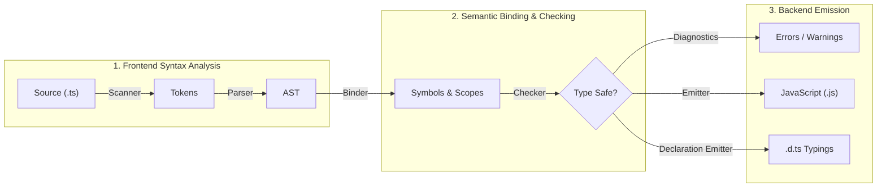

[← Back to Tech-21: TypeScript Deep Dive Overview](./README.md) | [🏠 Series Catalog](../../README.md)

---

# 1. What is TypeScript and How Does the Compiler Pipeline Work? 

## 1. The Core Concept & Intuition

TypeScript is a statically typed, syntactic superset of JavaScript developed by Microsoft. It adds an optional, compile-time type system to JavaScript that compiles down to clean, standards-compliant JavaScript that runs on any JS engine (browsers, Node.js, Deno, Bun).

A fundamental tenet of TypeScript is that **types are completely erased during compilation**. At runtime, TypeScript code runs as pure JavaScript with **zero runtime overhead**. The compiler serves two primary roles: static type validation through Control Flow Analysis (CFA), and source code transpilation down to target ECMAScript standards.

---

## 2. Under the Hood: The 5 Phases of the `tsc` Pipeline

The `tsc` compiler operates through five strictly ordered pipeline phases:

1. **Scanner**: Converts raw text characters into a stream of syntax tokens.
2. **Parser**: Consumes tokens and builds the **Abstract Syntax Tree (AST)** representing syntactic relationships.
3. **Binder**: Walks the AST and creates **Symbols**—associating declarations across scopes and linking identifier references to their declaration nodes.
4. **Type Checker**: The core brain of `tsc`. Traverses the AST and Symbol tables, verifies assignability rules, performs Control Flow Analysis (CFA), and generates diagnostic error messages.
5. **Emitter**: Strips out all type annotations, interfaces, and type aliases, transforms modern ES syntax down to target JavaScript (`target: "ES2022"`), and optionally outputs `.d.ts` declaration files and source maps.



| Pipeline Phase | Primary Input | Produced Artifact | Core Responsibility |
| :--- | :--- | :--- | :--- |
| **Scanner / Lexer** | Raw text stream (`.ts`) | Syntax tokens | Character normalization and keyword tokenization |
| **Parser** | Token stream | Abstract Syntax Tree (`SourceFile`) | Structural syntax validation and grammar checks |
| **Binder** | AST nodes | `Symbol` table & Scopes | Mapping declarations across files and merging scopes |
| **Type Checker** | AST + Symbols | Diagnostics & Type Cache | Static assignability rules, inference, and CFA |
| **Emitter** | AST + Typings | `.js`, `.js.map`, `.d.ts` | Type erasure, downleveling, and bundle artifact output |

---

## 3. Clean Code in Action

### A. Type Checking vs Transpilation
Modern bundlers (such as esbuild, SWC, Vite, and Babel) only perform **transpilation** (stripping types in microseconds) without type checking. `tsc` is run in CI or IDEs via `tsc --noEmit` to validate correctness:

```bash
# Fast type-check in CI pipeline without generating .js files
npx tsc --noEmit
```

```typescript
// TypeScript source:
interface User {
  id: number;
  name: string;
}

function greet(user: User): string {
  return `Hello, ${user.name}!`;
}

// Emitted JavaScript output (Types completely erased!):
function greet(user) {
  return `Hello, ${user.name}!`;
}
```

### B. Modern Isolated Declarations (`isolatedDeclarations: true`)
TypeScript 5.5 introduced `isolatedDeclarations`, requiring explicit return types on exports so tools like `swc` and `esbuild` can emit `.d.ts` files without a full type-checker run:

```typescript
// tsconfig.json: { "compilerOptions": { "isolatedDeclarations": true } }

// ❌ Error under isolatedDeclarations: inferred return type requires full checker
// export function fetchUserProfile(id: string) { return { id, active: true }; }

// ✅ Clean & Fast: Explicit typing enables instant parallel d.ts emission
export interface UserProfile {
  id: string;
  active: boolean;
}

export function fetchUserProfile(id: string): UserProfile {
  return { id, active: true };
}
```

---

## 4. Common Pitfalls & Interview Traps

| Trap / Misconception | Reality |
| :--- | :--- |
| **"TypeScript types provide runtime security and input validation."** | **False!** Types exist solely at compile time. Malicious JSON payloads from API responses bypass TS types completely. Use runtime validators (Zod / Valibot / ArkType) for boundary validation. |
| **"`tsc` won't emit JavaScript if there are type errors."** | By default, `tsc` emits JavaScript even when type errors exist! Enable `"noEmitOnError": true` in `tsconfig.json` to block output on error. |
| **"TypeScript adds performance overhead to runtime execution."** | **False.** Since all types are erased, the generated JavaScript executes at native JS speed. |
| **"`tsc` is required for modern web builds."** | `tsc` is often decoupled in modern pipelines: `vite`/`esbuild` transpile in milliseconds, while `tsc --noEmit` runs asynchronously in CI for type auditing. |

---

## 5. 60-Second Memory Anchor

> **"TypeScript is a compile-time static type layer over JavaScript. The `tsc` pipeline parses ASTs, binds symbols, checks assignability, and completely erases all type information during emission, leaving pure, zero-overhead JavaScript."**

---

[← Preface](./00-preface.md) | **Next**: [Question 02 →](./02-primitive-types-literal-types-and-type-widening.md)
