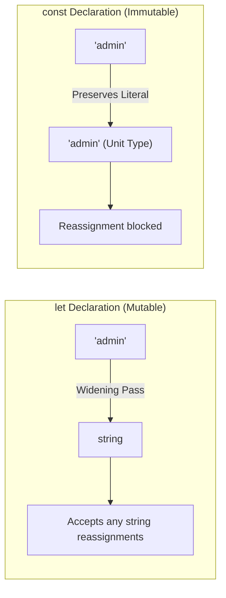

[← Back to Tech-21: TypeScript Deep Dive Overview](./README.md) | [🏠 Series Catalog](../../README.md)

---

# 2. How Do Primitive Types, Literal Types, and Type Widening Interact? 

## 1. The Core Concept & Intuition

In TypeScript, types form a set-theoretic hierarchy. At the foundation are primitive types (`string`, `number`, `boolean`, `bigint`, `symbol`, `null`, `undefined`). Each primitive represents an infinite set of potential runtime values.

TypeScript also supports **Literal Types**—where a specific value (e.g. `"admin"`, `404`, `true`) is treated as its own exact, single-member type. The compiler's automatic transition from a specific literal type to a broader primitive type is called **Type Widening**. Widening strikes a balance between static safety and mutable ergonomics when variables change across their lifecycle.

---

## 2. Under the Hood: Type Widening Mechanics & Inference Rules

When you declare a variable with `let`, TypeScript infers that its value may be reassigned later to any compatible value of that category, widening literal types to their primitive counterparts. When you declare with `const`, the reference cannot be reassigned, preserving the exact literal type:



| Declaration Pattern | Inferred Type | Widening Trigger | Immutability Level |
| :--- | :--- | :--- | :--- |
| `let role = "admin"` | `string` | Automatic widening on mutable bindings | Mutable |
| `const role = "admin"` | `"admin"` | Preserved literal unit type | Shallow reference |
| `const obj = { role: "admin" }` | `{ role: string }` | Object properties widen by default | Mutable object properties |
| `const obj = { role: "admin" } as const` | `{ readonly role: "admin" }` | Suppressed widening + deep `readonly` | Deeply immutable |

---

## 3. Clean Code in Action

### A. The Power of `as const` (Const Assertions)
Using `as const` instructs TypeScript to suppress type widening deeply across data structures:
1. Primitive properties are inferred as exact literals.
2. Object properties become compile-time `readonly`.
3. Array literals become fixed-length `readonly` tuples.

```typescript
// 1. Without 'as const' (Properties widen to string and number):
const configDefault = {
  endpoint: "https://api.nimman.com",
  retries: 3,
  debug: true
};
// Inferred type: { endpoint: string; retries: number; debug: boolean;
// }

// 2. With 'as const' (Deep immutable literal types):
const configConst = {
  endpoint: "https://api.nimman.com",
  retries: 3,
  debug: true
} as const;
// Inferred: { readonly endpoint: "https://api.nimman.com"; readonly
// retries: 3; readonly debug: true; }
```

### B. Narrowing APIs via Union of Object Values
Extracting literal union types from a readonly configuration dictionary:

```typescript
export const HTTP_STATUS = {
  OK: 200,
  CREATED: 201,
  BAD_REQUEST: 400,
  UNAUTHORIZED: 401,
  NOT_FOUND: 404,
} as const;

// Derive literal union type from dictionary values: 200 | 201 | 400 |
export type HttpStatus =
  (typeof HTTP_STATUS)[keyof typeof HTTP_STATUS];

function handleResponse(status: HttpStatus) {
  if (status === HTTP_STATUS.OK) {
    return "Success";
  }
  return "Error Code";
}
```

---

## 4. Common Pitfalls & Interview Traps

| Trap / Misconception | Reality |
| :--- | :--- |
| **"Object property literals are preserved when assigned to a `const` object."** | False. In `const obj = { method: "POST" }`, `method` widens to `string` because properties can be mutated at runtime. Use `as const` to freeze literal types. |
| **"`null` and `undefined` widen to `any` by default."** | Only when initialized without a type annotation and `"strictNullChecks": false`. Under modern strict mode, they widen to `null` and `undefined` respectively. |
| **"`as const` prevents runtime object modification."** | False. `as const` is purely compile-time. To prevent runtime mutation in JavaScript, combine it with `Object.freeze()`. |
| **"Literal numbers widen to `number` even in tuple declarations."** | Array literals widen to `number[]` unless asserted with `as const` or given an explicit tuple annotation like `[number, number]`. |

---

## 5. 60-Second Memory Anchor

> **"`let` widens literal values to general primitives (`string`, `number`); `const` preserves narrow literal types. Use `as const` on objects and arrays to freeze properties deeply into readonly literal types."**

---

[← Question 01](./01-what-is-typescript-and-the-compiler-pipeline.md) | **Next**: [Question 03 →](./03-any-unknown-never-and-void.md)
