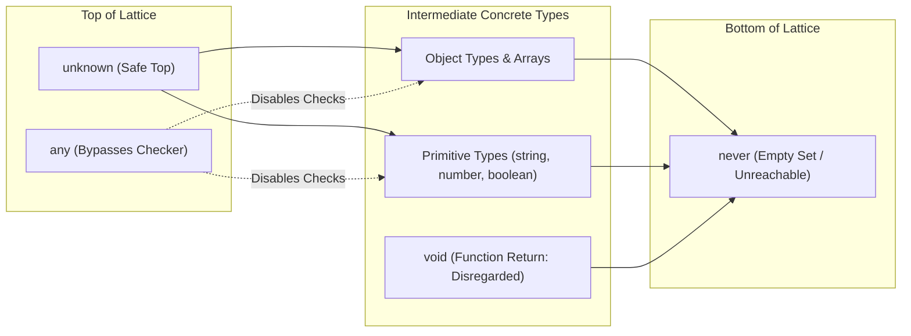

[← Back to Tech-21: TypeScript Deep Dive Overview](./README.md) | [🏠 Series Catalog](../../README.md)

---

# 3. What Are Top and Bottom Types, and When Should You Use `any`, `unknown`, `never`, and `void`? 

## 1. The Core Concept & Intuition

In type theory, a static type system forms a directed lattice bounded by two extremes:
1. **Top Types (Universal Super-types)**: Types that can accept *any* value in the system (`any` and `unknown`).
2. **Bottom Type (Empty Set)**: A type that can accept *no* value (`never`).

Understanding how `any`, `unknown`, `never`, and `void` interact within TypeScript's assignability hierarchy is essential for building type-safe applications and preventing silent runtime failures.

---

## 2. Under the Hood: The Type Hierarchy & Subtyping Lattice

`unknown` sits at the very apex of TypeScript's type lattice. Everything is assignable to `unknown`, but `unknown` is assignable to nothing except itself and `any`. In contrast, `any` is an escape hatch that bypasses the type checker completely. `never` sits at the very bottom: it has no elements, making it assignable to all types, while no type (except `never`) can be assigned to it.



| Type | Can Assign Anything TO It? | Can Assign It TO Anything? | Can Call Methods Directly? | Type Safety Guarantee |
| :--- | :--- | :--- | :--- | :--- |
| **`unknown`** | ✅ Yes | ❌ Only to `unknown` or `any` | ❌ Requires type guard first | ✅ Complete type safety |
| **`any`** | ✅ Yes | ✅ Yes (except `never`) | ✅ Yes (disables compiler) | ❌ Zero static safety |
| **`never`** | ❌ No (empty set) | ✅ Assignable to everything | ❌ N/A (unreachable code) | ✅ Exhaustiveness verification |
| **`void`** | ❌ Only `undefined` | ❌ Only `void` / `any` | ❌ N/A | Return value ignored by caller |

---

## 3. Clean Code in Action

### A. Safe API Parsing using `unknown` + Type Narrowing

```typescript
// UNSAFE: Using 'any' allows calling nonexistent methods without
// compiler warnings
function parseUnsafe(json: string): any {
  return JSON.parse(json);
}
const data = parseUnsafe('{"name": "Manoj"}');
// data.nonExistentMethod(); // Compiles fine, crashes at RUNTIME!

// TYPE-SAFE: Using 'unknown' forces callers to validate data shape
// first
function parseSafe(json: string): unknown {
  return JSON.parse(json);
}
const raw = parseSafe('{"name": "Manoj"}');

// Compiler blocks: raw.name (Object is of type 'unknown')

if (typeof raw === "object" && raw !== null && "name" in raw) {
  const verified = raw as { name: string };
  console.log(`Hello, ${verified.name}`); // 100% Type-Safe!
}
```

### B. Exhaustive Type Checking with `never`

```typescript
type Status = "pending" | "approved" | "rejected";

function handleStatus(s: Status): string {
  switch (s) {
    case "pending": return "In Review";
    case "approved": return "Success";
    case "rejected": return "Declined";
    default: {
      // If a new status is added to 'Status' type, this line fails at
      // COMPILE-TIME!
      const exhaustiveCheck: never = s;
      throw new Error(`Unhandled status: ${exhaustiveCheck}`);
    }
  }
}
```

---

## 4. Common Pitfalls & Interview Traps

| Trap / Misconception | Reality |
| :--- | :--- |
| **"`any` is harmless if isolated to API layers."** | `any` is viral and contagious. Assigning an `any` return value infects receiving variables, silencing compiler errors across the downstream call graph. Always use `unknown`. |
| **"`void` and `undefined` are completely identical return types."** | A function returning `void` permits returning any value which the caller simply ignores (e.g. `[1, 2].forEach(x => set.add(x))`). A function typed with `undefined` strictly requires `return undefined;`. |
| **"`never` can accept `null` or `undefined`."** | `never` is an uninhabited bottom type. Absolutely no value can be assigned to `never` except another `never`. |
| **"`JSON.parse()` returns `unknown` by default."** | By default, TypeScript types `JSON.parse` as returning `any`. Always explicitly cast or wrap it in a function returning `unknown`. |

---

## 5. 60-Second Memory Anchor

> **"`any` turns off the type checker completely. `unknown` is the type-safe top type that forces you to narrow before use. `never` is the bottom type representing impossible states, perfect for exhaustive switch checks."**

---

[← Question 02](./02-primitive-types-literal-types-and-type-widening.md)

> ### 🎓 Looking for Questions 04 through 21 & Deep-Dive Appendices?
> You have reached the end of the free sampler for **Tech-21: TypeScript Deep Dive**!
> 
> The full release contains **18 additional core interview chapters** plus **2 architectural reference appendices**, memory layouts, complete edge-case tables, and production patterns.
> 
> 📖 **[Get the Full Edition (Kindle / EPUB / PDF) →](./README.md#how-to-get-the-full-edition)**

