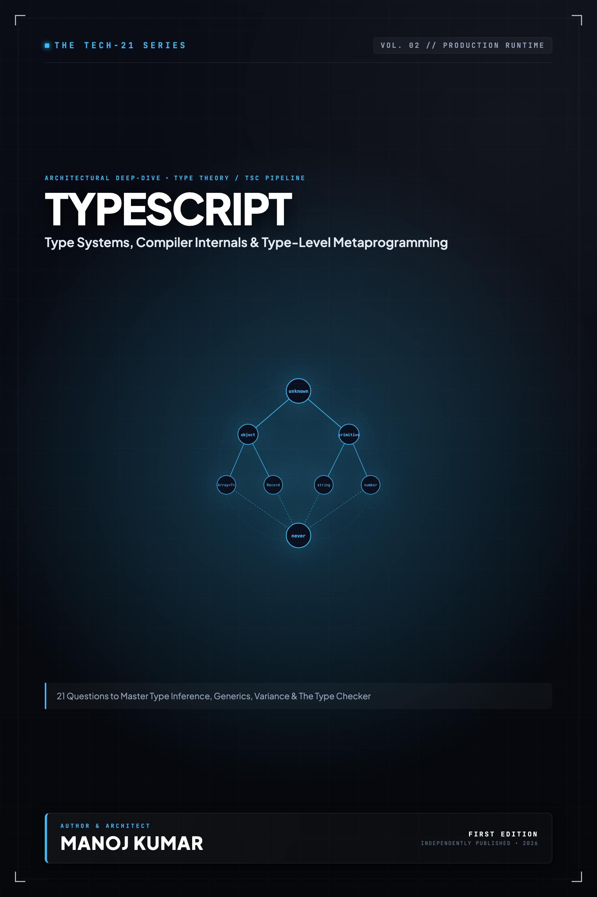

# Tech-21: TypeScript Deep Dive

> **21 Questions to Master the Type System, Compiler Mechanics, and Type-Level Metaprogramming**  
> *Author: Manoj Kumar* • *Tech-21 Series (Vol. 02)*

  

## 📖 About This Edition

This repository contains the **free public sampler** for **Tech-21: TypeScript Deep Dive**, including the **Preface and Questions 01 through 03** in their entirety. Every chapter follows the strict 5-section Tech-21 mental model framework:

1. **The Core Concept & Intuition** (High-signal problem statement & architecture)
2. **Under the Hood** (Runtime execution mechanics, memory diagrams, and comparison matrices)
3. **Clean Code in Action** (Idiomatic, production-grade implementations)
4. **Common Pitfalls & Interview Traps** (Structured bug-prevention matrices)
5. **60-Second Memory Anchor** (Permanent retention punchlines)

## 📋 Complete 21-Question Syllabus

| Chapter | Status | Title |
| :--- | :---: | :--- |
| **[00-preface](./00-preface.md)** | 🟢 **Free Sampler** | [Preface](./00-preface.md) |
| **[01-what-is-typescript-and-the-compiler-pipeline](./01-what-is-typescript-and-the-compiler-pipeline.md)** | 🟢 **Free Sampler** | [1. What is TypeScript and How Does the Compiler Pipeline Work?](./01-what-is-typescript-and-the-compiler-pipeline.md) |
| **[02-primitive-types-literal-types-and-type-widening](./02-primitive-types-literal-types-and-type-widening.md)** | 🟢 **Free Sampler** | [2. How Do Primitive Types, Literal Types, and Type Widening Interact?](./02-primitive-types-literal-types-and-type-widening.md) |
| **[03-any-unknown-never-and-void](./03-any-unknown-never-and-void.md)** | 🟢 **Free Sampler** | [3. What Are Top and Bottom Types, and When Should You Use `any`, `unknown`, `never`, and `void`?](./03-any-unknown-never-and-void.md) |
| **04-type-aliases-vs-interfaces** | 🔒 *Full Edition* | 4. How Do Type Aliases and Interfaces Differ in Extensibility and Declaration Merging? |
| **05-structural-typing-and-duck-typing** | 🔒 *Full Edition* | 5. How Does Structural Typing Work, and Why Does Excess Property Checking Occur? |
| **06-union-and-intersection-types** | 🔒 *Full Edition* | 6. How Do Union and Intersection Types Model Set-Theoretic Logic? |
| **07-discriminated-unions-and-exhaustive-checking** | 🔒 *Full Edition* | 7. How Do Discriminated Unions Enable Exhaustive Type Checking? |
| **08-type-narrowing-and-type-guards** | 🔒 *Full Edition* | 8. How Does Control Flow Analysis Narrow Types, and When Should You Use Custom Type Guards? |
| **09-generics-and-type-constraints** | 🔒 *Full Edition* | 9. How Do Generics and Type Constraints (`extends`) Enforce Type Relationships? |
| **10-keyof-typeof-and-indexed-access** | 🔒 *Full Edition* | 10. How Do `keyof`, `typeof`, and Indexed Access Types Query and Extract Types? |
| **11-mapped-types-and-modifiers** | 🔒 *Full Edition* | 11. How Do Mapped Types, Modifiers, and Key Remapping Transform Data Structures? |
| **12-conditional-types-and-infer** | 🔒 *Full Edition* | 12. How Do Conditional Types Distribute Over Unions, and How Does `infer` Unpack Types? |
| **13-template-literal-types** | 🔒 *Full Edition* | 13. How Do Template Literal Types Enable Type-Safe String Pattern Manipulation? |
| **14-built-in-utility-types-internals** | 🔒 *Full Edition* | 14. How Do TypeScript's Built-in Utility Types Work Under the Hood? |
| **15-enums-vs-const-enums-vs-objects** | 🔒 *Full Edition* | 15. Why Should You Prefer Object Literals (`as const`) Over Enums and Const Enums? |
| **16-classes-access-modifiers-and-parameter-properties** | 🔒 *Full Edition* | 16. How Do Access Modifiers, Parameter Properties, and Private Fields Work in Classes? |
| **17-function-overloads-and-this-parameter** | 🔒 *Full Edition* | 17. How Do Function Overloading and Contextual `this` Typing Work Internally? |
| **18-ambient-declarations-and-d-ts-files** | 🔒 *Full Edition* | 18. What Are Ambient Declarations, and How Do `.d.ts` Files Bridge JavaScript and TypeScript? |
| **19-modules-namespaces-and-module-resolution** | 🔒 *Full Edition* | 19. How Does Modern Module Resolution Work Across ESM, CommonJS, and Bundlers? |
| **20-decorators-and-metadata-reflection** | 🔒 *Full Edition* | 20. How Do Modern Stage 3 Decorators Differ from Legacy Experimental Decorators? |
| **21-tsconfig-best-practices-and-strict-mode** | 🔒 *Full Edition* | 21. What Flags Constitute `strict` Mode in `tsconfig.json`, and Why Are They Essential? |
| **22-appendix-type-system-cheat-sheet** | 🔒 *Full Edition* | Appendix A: Type Hierarchy and Assignability Matrix |
| **23-appendix-utility-types-reference** | 🔒 *Full Edition* | Appendix B: Advanced Type Transformations Cheat Sheet |

---

## 🚀 How to Get the Full Edition

The complete edition unlocks **all 21 in-depth questions** and **both architectural reference appendices** (over 100+ pages of high-signal diagrams, memory layouts, and interview pitfall tables):

- 📱 **Kindle Edition**: Available on [Amazon Kindle](https://amazon.com)
- 📄 **Digital DRM-Free Bundle (EPUB + PDF)**: Instant download with high-res interior graphics
- 📦 **All-Access Pass**: Access all 13 volumes across the entire Tech-21 series

[← Return to Series Catalog](../../README.md)
